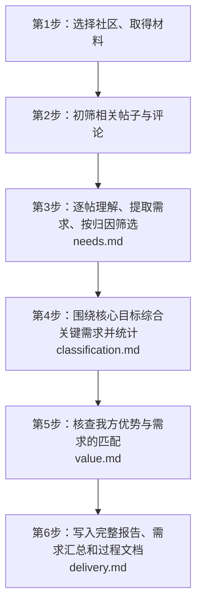

# Reddit 社区需求调研

**初筛保留与本轮研究问题相关、表达困难、不满或具体愿望的内容。深入阅读后形成具体需求，围绕研究问题综合出有助于用户作出决定的结论。数量说明出现范围，产品能力用于判断改善价值。**

痛点需要具体目标、实际障碍或不愿承受的代价，以及原文依据。只有具体愿望时记录需求。工具和平台的实际职责进入理解；产品是否有机会改善，留到提取之后判断。

## 核心研究目标

模型 API 服务需求研究必须围绕以下目标执行：

> 找出足以影响用户选择 API 服务的关键需求，结合我们能够提供的实际优势，判断什么理由能让他们愿意尝试、付费或把调用转移过来。

这个目标必须进入 `research.md`、分析批次和需求综合任务。第四步必须形成带有具体情境、任务、代价或选择条件的需求结论，第五步核查我们的实际优势能否满足这些条件。完整研究必须交付对应的判断、原文依据和能力证据；材料不足之处明确保留。其他研究采用用户确认的目标。

## 流程与文档分工

## 从当前进度继续

从完整对话和已有结果中恢复用户已经确认的研究目标。明确要研究谁的什么问题、结果用于什么决定，再确定社区、时间范围、产品背景及交付位置。已有答案直接采用；缺失信息会改变纳入哪些需求时询问。

在任务工作目录保存 `research.md`，分别记录研究问题、综合需求要回答的问题与资料范围，说明研究对象在使用过程中负责什么、与其他工具有什么关系，以及需求的纳入条件。社区名单用于定位资料；逐条需求的纳入依据来自研究问题。研究整个社区时可以采用全社区范围；围绕特定产品或使用任务时保留该主题范围。

`research.md` 同时保存资料路径、已完成步骤、工具与社区背景、用户确认和待解决问题。继续逐帖分析、分配批次或更换执行者时，一起提供研究问题、相关性标准与资料位置，并先阅读这些内容。新的处理方式和交付要求沿用已确认的主题范围，用户改变研究目标时更新记录。

完整研究默认交付到 Notion。启动时沿用已确认的位置，检查目标页面的访问权限并记入 `research.md`；确实缺少位置时询问，同时继续资料分析。用户明确指定其他交付位置时采用其要求。

只做采集、初筛或局部复核时，完成用户指定阶段。完整研究按以下流程进行。

## 1. 选择社区、取得材料

读取 [collection.md](references/collection.md)。先认识相关工具的用途与用户任务，结合真实讨论选择社区。社区名称和关键词命中比例用于发现线索，重要性结合工具用途判断。

批量取得范围内的帖子和评论，保留原文、回复关系、时间、作者、链接和互动信息。普通讨论、经验分享、集中讨论与成人话题按研究范围保留。主题分布使用全部取得的资料。

复用已有数据；新采集使用配套脚本或已验证的读取工具。脚本负责采集、整理和统计。初筛与需求理解由 Agent（智能体）完成。

## 2. 初筛相关内容

开始筛选或分配阅读任务前，读取 [needs.md](references/needs.md)。结合已有资料，抽样阅读不同时间和不同类型的完整讨论，了解用户在做什么、常用词和工具关系，记入 `research.md`。

正文与评论分别筛选，保留与研究问题相关的困难、不满或具体愿望，说明关联及原文依据。关联或含义尚不明确时保留待深入阅读；明确无关的内容保留原资料。主帖未入选，评论仍能入选。图像或外链承载主要内容时，记录需补读的来源。

几十万条资料分批筛选，每批只输出筛选决定和依据；深入理解集中在入选讨论。使用当前可用的 Agent 能力。外部模型服务、模型名称和费用范围由本次授权决定；调用方式尚未确定时，先完成资料和批次准备，再明确所缺信息。

## 3. 深入阅读，逐条提取

对入选内容读取完整帖子、评论关系和作者后续。使用情境模型连接人物、目标、操作、结果和后续解释；遇到不懂的工具或说法就查资料，再返回原文。

字面抱怨或功能建议不足以说明具体障碍时，按 [needs.md](references/needs.md) 中的语用推理方法，结合发生经过和作者回应理解隐含诉求，保留原表述与推断依据。

按 [needs.md](references/needs.md) 中的框架含义、阅读动作和字段说明完成分析。在完整讨论中逐项判断与研究问题的关系，保存范围内的具体痛点与需求，一篇可以有多项。用质性内容分析保留原意。原话支持到哪一步，结论就写到哪一步；原因不明时保留事实与疑问。

每条记录只增加 `attribution`（问题归属）这一个标签字段。根据已有分析填写归属，按 [归因筛选](references/needs.md#按归因筛选) 形成进入第四步的保留记录；全部逐条记录保存在过程资料中。

把会影响主要结论、存在理解冲突的材料集中呈现给用户，附原文、上下文和解释。常规阅读与数据处理自主完成。用户纠正后，处理采用相同误解的记录和关联结论。

## 4. 围绕研究问题综合需求并统计

综合或统计前读取 [classification.md](references/classification.md)，按其中的逐批流程执行。使用配套 `read-findings` 命令一起读取完整分析记录与对应原文，每批完成归类并保存现有类别后再继续。使用第三步已经筛选保留的记录，按[核心研究目标](#核心研究目标)决定比较和归并的标准。研究用户选择时，必须围绕哪些问题足以影响尝试、付费或更换服务重新理解和综合记录，保留实际任务、代价、取舍与选择条件。已有分类可以调整，独立需求单独成项，只有一条来源也保留。

每项汇总需求保存全部成员编号，具体含义、代表经历和统计范围保持一致。需求目录按独立讨论数展示，正文围绕对本轮研究决定有意义的发现组织。不同账号数、作为具体需求来源的评论数、互动量分别统计。集中讨论帖使用独立问题及其回复作为讨论单位，记录问题起点。

计数使用配套 `count` 命令并显式指定纳入的问题归属标签。每项汇总需求按全部成员去重计数。讨论单位、原文引用和来源对应错误直接修正后重跑；初筛命中数与确认需求数分别记录。

## 5. 判断改善价值

读取 [value.md](references/value.md)，结合研究目标核查现有工具、平台、模型和供应商的能力。说明哪些需求已有办法、哪些仍有使用困难、产品能改善什么。核查使用当时适用的资料，当前机会使用当前能力判断。

平台目前缺少的功能也可以提出。区分已有能力的改善与新增能力，说明用户需求、建议内容、预期作用和待确认条件。

研究目标涉及获客、试用、付费或迁移时，沿用第四步形成的关键需求，核对我们能提供什么对应优势、哪些能力还需改善或验证，以及材料支持何种行动。用户需求与我方能力的判断一起进入同一项结论。

把数量较多、影响研究方向和容易混淆的重要共性集中呈现给用户，附合并理由、不同意见及已有办法。数量少但会明显改变本轮决定的需求保留说明。

## 6. 交付与继续

制作报告或写入文档前读取 [delivery.md](references/delivery.md)。完整调研报告包含讨论主题、场景与行为、社区特点与价值取向、痛点与需求，以及适用专题。需求模块链接需求汇总报告，其中同时呈现共性需求与单一需求，再链接逐帖过程文档。

基础内容不足以回答本轮研究问题时，先写清还缺什么解释，再按 [topics.md](references/topics.md) 的对应部分选择补充专题。使用其中的框架说明、分析步骤、原始依据和呈现方式，复用已有证据。

使用可用的 Notion 写入工具，必要时使用有访问权限的已授权浏览器。创建或更新完整调研报告、需求汇总与过程页面，连接并读回核对。完整研究的完成条件包含实际写入成功，以及返回完整报告和需求汇总链接；写入受阻时保留完整本地草稿，明确说明 Notion 交付尚未完成及具体阻碍。

更新 `research.md` 的真实进度。保留原始数据、筛选记录、具体需求、共性说明及最终报告，清理本次不再需要的临时文件和运行进程。
