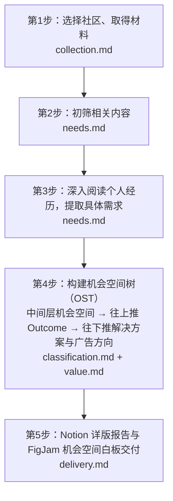

# Reddit 社区需求调研与机会空间构建

## 核心研究目标

以增长和广告为目的的社区研究围绕以下目标执行：

> 从真实的使用经历和需求中，找出有增长潜力、值得投入的**机会空间（Opportunity Space）**、**解决方案**与**广告方向**，为吸引合适用户、促成尝试和付费、争取更多使用提供依据。研究结果应帮助决定广告围绕什么展开，以及产品怎样兑现相应的价值。

模型 API 研究重点关注服务选择与调用转移。其他研究采用用户确认的目标。研究目标决定阅读、机会空间综合与方案判断的重点。

## 表达要求

所有对人交付的产物（Notion 报告、逐帖需求档案、FigJam 白板、汇总表、`groups.md`、`research.md`）均遵循以下要求：

1. **发布会标准与正向性叙事**：成品面向读者审阅和决策，直接呈现结论、机会空间、用户痛点、解决方案与原帖证据。防御性解释改成正向性叙事。
2. **减少模型惯性**：减少二分叙事。降低排比、对比句式的比例。减少模型的惯性。
3. **直白口语**：使用自然、平实的日常词句，保留通用技术简称，不堆砌生造的工程术语，能用一句话说清的就用一句话。
4. **标题直指核心**：各层标题用不带逗号的完整短句，直接点明用户面对的具体阻碍、期望改善或方案做法；标题下方用一两句话展开具体需求和常见场景。

## 流程与文档分工

## 并行提效与质量保障

多社区调研可通过子代理并行分工缩短耗时，同时保持逐帖理解与核对质量：

1. **阶段 1–3 按社区并行执行**：涉及多个社区时，按社区派发子代理同时完成采集、初筛和第三步逐帖精读，各自产出 `findings_<subreddit>.jsonl` 后合并。
2. **阶段 2 聚焦有效讨论**：初筛保留包含具体困难、不满、选型原因或明确愿望的讨论，过滤无关水帖，减少第三步的无效阅读量。
3. **阶段 4 统一骨架与逐帖核对**：主 Agent 统一定好机会空间树结构，可按主题派子代理并行执行单帖反向核对和代表原话挑选。
4. **阶段 5 同源数据生成双端交付**：用同一份结构化机会空间数据生成 Notion 报告内容与 FigJam 白板内容。

## 从当前进度继续

读取完整对话和已有成果，在 `research.md` 保存研究目标、资料范围、产品背景、资料路径、进度、Notion 主文档链接、FigJam 白板链接及逐帖资料位置。继续分析或交接批次时一起提供。已有答案直接采用，影响研究范围的缺失信息再询问。

复用已有资料与已确认的更正。每完成一个阶段，按 [delivery.md](references/delivery.md) 更新对应交付物并核对。

## 1. 选择社区、取得材料

按 [collection.md](references/collection.md) 认识相关工具与用户任务，选择社区，取得范围内可获取的帖子和评论。保存原文、回复关系、时间、作者、链接及资料缺口。主题分布使用全部取得的资料。

脚本负责采集、整理和统计，内容理解由 Agent 完成。外部模型服务、费用与调用范围遵循本次授权。

## 2. 初筛相关内容

按 [needs.md 的相关性初筛](references/needs.md#按相关性初筛)分别阅读正文和评论，结合整段意思判断是否包含与研究对象有关的具体困难、不满、寻找办法或愿望。相关内容保留，明确无关或没有相关需求线索的内容排除，缺少上下文的内容留待补读。在 `screen.jsonl` 保存原句、判断结果及理由，把保留和含义待确认的讨论交给第三步。

## 3. 深入阅读，逐条提取

按 [needs.md](references/needs.md) 将情境模型与语用推理结合使用，理解完整经历与言外之意，再用直白口语提取具体需求。每项记录保留原文、条件和后续，填写 `attribution`（问题归属）与 `action`（真实行动等级及原话证据），按本轮范围筛选。

按 [问题归属](references/needs.md#按归因筛选)确认原文中的问题涉及哪个对象，再与本轮纳入范围比较。范围内的需求进入第四步；范围外的记录保留归因依据；归属不清的记录写明疑问并补读材料。

## 4. 构建机会空间树（OST），提取解决方案与广告方向

按 [classification.md](references/classification.md) 使用 `read-findings` 读取第三步记录与原文。围绕研究目标，保留能帮助发现广告方向或产品改进机会的真实需求；无价值的记录留空 `need_id` 淘汰。

1. **整理中间层机会空间**：第一轮结合每项需求的触发情境、期望结果、现有办法和行动动机发现具体机会；第二轮用亲和图法按共同目标和痛点整理成**机会空间**。机会空间可以分层，也可以不分层。
2. **向上推导 Outcome Space**：根据中间层机会空间，向上归纳顶层的 Outcome Space（核心结果）。能整合进同一个 Outcome Space 的机会放在一起，不能整合的单独列出。
3. **向下推导解决方案与广告方向**：完成两轮机会提取后，按 [value.md 的重点方向判断](references/value.md#判断哪些机会值得展开)比较用户实际行动、问题影响、可能争取的使用或付费，以及兑现价值所需的改进与投入，说明重点方向的选择理由。再按 [delivery.md](references/delivery.md) 展开解决方案，解决方案后面紧跟广告方向。
4. **单帖反向核对与代表帖核验**：对每项机会下的帖子执行单帖反向核对，从中挑选主旨直接聚焦该项机会的 1 个代表帖子（或代表评论）及 1 句用户原话（配中文译文）。

保存主题及广告方向各自的支持记录。使用 `count` 核查原文与行动证据，按实际成员统计独立讨论、账号、表达来源评论、帖子、点赞合计、行动等级分布、高争议主帖及各社区分布（`by_subreddit`），同组重复来源去重。

## 5. 双端交付与完成核对（Notion + FigJam）

按 [delivery.md](references/delivery.md) 完成 Notion 调研报告与 FigJam 机会空间白板的同步交付：

- **Notion 与 FigJam 一一对应且分工明确**：FigJam 呈现全局机会空间树结构；Notion 展开每项机会的具体需求、常见场景、解决方案、代表原话及折叠的全量证据，并在 Notion 中附上对应的 FigJam 链接。
- 需要补充专题时读取 [topics.md](references/topics.md)。结束时核对内容、数量、来源和链接，更新 `research.md`。
