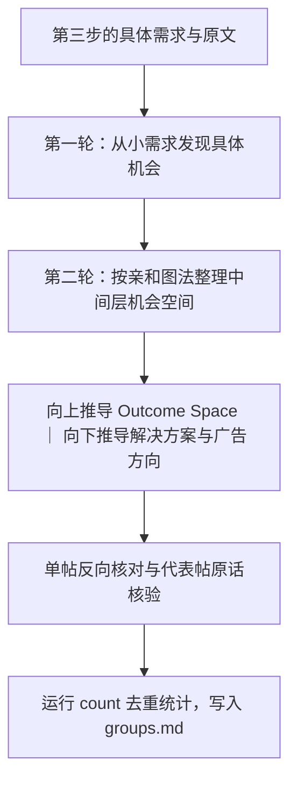

# 第四步：机会空间树构建与广告方向提取

输入是第三步[按归因筛选](needs.md#按归因筛选)保留的记录，目标见 [SKILL.md](../SKILL.md#核心研究目标)。

## 构建机会空间树（Opportunity Space Tree）

我们从社区讨论中找出来的核心是中间层的**机会空间（Opportunity Space）**。一起读取 `statement`、`situation`、`follow_up` 及原文，完成机会提取并构建机会空间树：

1. **第一轮：从具体需求发现机会。** 逐项理解小需求中的触发情境、期望结果、现有办法和行动动机，按 [广告方向判断](value.md) 识别值得展开的线索。即使只有一条来源，也可以保留明确而有价值的机会，并说明证据范围。
2. **第二轮：整理中间层机会空间。** 用亲和图法将相关需求整理为**机会空间**。机会空间可以分层，也可以不分层，按材料本身的聚合关系自然组织。
3. **向上推导 Outcome Space。** 根据整理好的中间层机会空间，向上推导顶层的 Outcome Space（核心结果）。能整合进同一个 Outcome Space 的机会放在一起，不能整合的单独列出。
4. **向下推导解决方案与广告方向。** 按 [value.md](value.md) 和 [delivery.md](delivery.md) 往下推导解决方案，解决方案后面跟着广告方向。



## 怎样筛选与写清机会空间

**亲和图法（Affinity Diagramming）**：把零散的具体需求按共同的目标和痛点归拢到同一机会主题下，方便对比共性与差异。

围绕核心研究目标筛选并组织机会空间：

1. **淘汰无价值记录**：只保留能帮助发现广告方向或产品改进机会的真实需求；没有价值的记录不归入任何机会主题（`need_id` 留空，统计时自动跳过）。
2. **合并相同机会**：当用户希望达成的具体结果一致、且卡住他的具体障碍也一致时，合并为同一项具体机会。
3. **机会空间的写法**：
   - **机会空间标题**：用不带逗号的平实动宾短语，直接点明用户遇到的具体阻碍或期望达成的改善，不堆砌生造术语。
   - **需求与场景展开**：在标题下方用一两句大白话把具体需求和常见触发场景说清楚。多社区调研中，若不同社区人群对同一机会的关注角度存在明显差异，用一句话说明各社区各自的关注重点。防御性解释改成正向性叙事，减少二分叙事，降低排比、对比句式的比例，减少模型的惯性。概括多条来源时忠实于原文事实，区分用户的猜测与已确认的情况，不同来源的独立问题分别表述。
4. **单帖反向核对与代表帖核验**：
   - 归类完成后，对照机会空间标题逐条反查组内的每篇帖子和评论，如果单看这条来源的原话推不出该需求，或者原帖只是顺带提及背景，将其移出该机会。
   - 从通过核对的记录中，为每项机会挑选**主旨直接聚焦该项机会**的 1 个代表帖子（或代表评论，直达 Reddit 对应链接）和 1 句用户原话（配中文译文）；仅在讨论其他话题时顺带提及该痛点的综合帖，只作组内统计依据，不选作对外展示的代表帖。

每条广告方向围绕一个统一的购买理由与核心承诺展开。当多个具体机会共同服务于同一个承诺时，可共用一条广告方向，在最合适的位置集中分析、其他位置引用；当不同机会对应不同的购买理由，或同一机会下包含多个独立的吸引卖点时，分别立为独立的广告方向。同一条原始记录可以支持多个方向，各方向分别保存真正支持它的成员。

## 分批执行与保存

使用 [read-findings](collection.md#分批读取分析记录与原文) 一起读取完整分析记录、表达原文及已取得的上下文。需要更多回复时使用 `thread`。主 Agent 统一定好机会空间树骨架后，可按机会主题派发子代理并行执行单帖反向核对与代表原话挑选。

将每条记录的 `need_id` 与 `groups.md` 中的成员对应起来。`groups.md` 是供整理、统计与生成 Notion / FigJam 使用的同源本地分析文件，每个机会主题保存：

- 所属 Outcome Space、机会空间名称、共同关注点，以及包含的具体机会标题与需求说明。
- 全部 `finding_ids`，各项诉求的条件与差异对应的记录。
- 每项具体机会后面直接配 1 句用户原话（附中文译文）和 1 个代表帖子（直达 Reddit 原链接）。
- 对应的解决方案与广告方向分析，以及该方向实际支持记录的 `finding_ids`。
- 独立讨论数、账号数、表达来源评论数、点赞合计（净得分）、真实行动三档分布（`actions`）、高争议主帖数（`contested_posts`）及分社区统计（`by_subreddit`）。

## 统计规则

主要数量是表达该机会下需求的独立讨论数。按集合去重，同一讨论在同一机会或主题中只计一次。

- 普通帖子及其评论作为一个讨论。集中讨论帖按独立问题及其回复计数，使用问题起始评论作为 `discussion_id`；最上层评论只是分类分区时，找到实际问题的起点。
- 不同发言账号、表达来源评论、涉及帖子与高争议主帖（`contested_posts`）分别计数。删除或未知账号不作为已知独立用户。
- `actions` 按独立讨论统计真实行动等级（`acted`、`seeking`、`expressing`）：同一讨论包含多条记录时，按该讨论内达到的最高行动档位计入一次，三档之和等于该组独立讨论总数。`count` 会校验 `acted` 与 `seeking` 的 `action_evidence` 确系同一表达作者在同一讨论内的原文原话。
- `by_subreddit` 按表达来源所属社区分别输出去重后的讨论数、账号数、评论数、帖子数、高争议主帖数、行动等级分布与点赞合计，供判断痛点集中的主力社区与跨社区差异。
- 表达来源使用 `source_id`；补充解释或被引用的评论保留为证据。
- 点赞合计使用表达来源的 `score`（赞成票减去反对票）。同组按 `source_id` 去重后相加；同一来源提取了多项需求也只计一次。评论作为表达来源时，计入该评论分数；原帖仅作为背景时不计入。负分按原值相加。[Reddit 分数定义](https://developers.reddit.com/docs/api/public-api/classes/Post#score)
- `score_total` 保存有分数来源的合计，`scored_sources` 保存其数量。缺少分数时标明已统计来源数与总来源数；全部缺失时合计为 `null`，报告写“暂无数据”。分数采用资料中保存的数值，报告开头注明采集范围与时间。
- 同一来源可能涉及不同主题，各组数量与点赞合计可能重叠；需要全报告总量时，跨组重新按来源去重。点赞合计表示这些内容的互动情况。
- 初筛命中数与确认需求数分别记录。
- 广告方向使用自己的支持记录计数。主题总量不能直接作为其中某个方向的支持数量；单条机会和少数人的明确行为仍可独立保留。

填写 `need_id` 后执行：

```bash
python3 scripts/reddit_research.py count --db /绝对路径/research.sqlite --findings /绝对路径/findings.jsonl --include-attribution API服务 --include-attribution 模型能力 --out /绝对路径/counts.json
```

`--include-attribution` 使用本轮纳入的标签，可重复指定。集中讨论帖通过 `--megathread t3_帖子编号` 声明，多个帖子重复传入。程序核查来源、引文和回复关系，再按实际成员计数。

需要广告方向的数量时，对每个方向使用其支持记录的独立副本，将 `need_id` 设为该方向编号后运行同一命令。每个副本中的记录编号保持唯一，原始主题归属继续保留。
