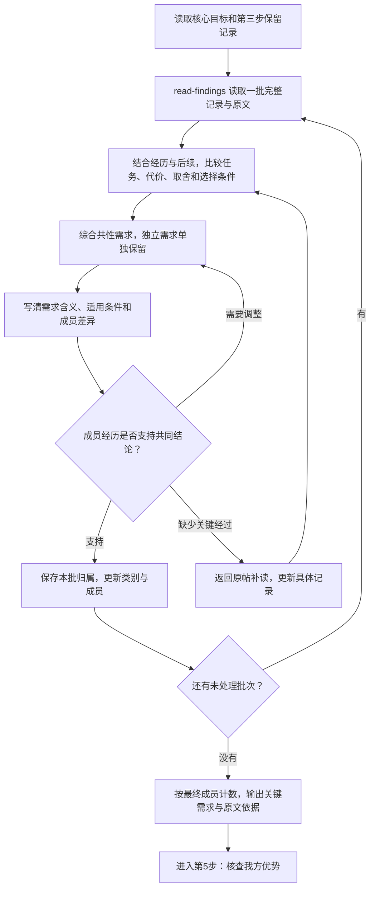

# 第四步：需求综合与统计

输入是第三步按[归因筛选](needs.md#按归因筛选)保留的具体记录；输出是关键需求、成员依据与统计。第五步的产品能力核查见 [value.md](value.md)。

## 从逐条记录形成需求汇总

输入是逐帖分析中按 `attribution`（问题归属）筛选后保留的记录。综合的标准来自本轮研究要帮助用户作出的决定。需求汇总同时包含归并后的共性需求和独立需求，每项保留具体场景、障碍、希望结果与选择条件。只有一条帖子的需求也完整保留。

接续已有分析时，先核对它的研究问题是否与本轮目标一致。目标或纳入范围变化时，返回 [needs.md](needs.md) 完成受影响记录的理解与筛选，再使用确认保留的记录综合和计数。

这一步沿用质性内容分析中的“比较具体含义、归为类别”：先理解每条记录，再比较共同部分和差异，根据材料逐步形成类别。[原始方法](https://doi.org/10.1016/j.nedt.2003.10.001)

### 按研究目标确定综合标准

开始归并时，必须带入 [SKILL.md 中的核心研究目标](../SKILL.md#核心研究目标)及本轮完整任务要求。研究目标涉及获客、试用、付费或迁移时，必须围绕“这个问题为什么重要到足以影响用户选择服务”比较记录：用户要完成的任务、正在作出的决定、愿意接受的取舍，以及促使他寻找、购买、更换或继续使用的条件。

综合后的需求名称和解释必须体现这些实际条件，并由成员经历支持。已有主题目录和分类可以重新组织；同一主题下存在不同选择时分别归纳，不同表面问题共同影响同一种决定时可以一起解释，保留具体困难与差异。用户没有表达选择行动的需求照常保留，按材料支持的目标和条件解释其意义。

### 综合流程



使用 [read-findings](collection.md#分批读取分析记录与原文) 取得一批完整分析记录及其原文。对照表达来源的完整原文，连同 `situation`、`follow_up`、`resolution` 和 `uncertainty` 理解作者最后明确的诉求或选择。记录与原文冲突时，先修正这条记录的主要描述和相关字段，再决定归属。需要完整回复时使用 `thread`。反对意见、已解决经历及结果未知的情况保留其实际含义；只在部分成员中出现的条件写入对应情况。

每批完成后，在 `groups.md` 更新需求含义、适用条件及全部 `finding_ids`，将编号回填到具体记录的 `need_id`，再按 `next_start` 读取下一批。`research.md` 保存已完成范围。类别含义改变时，读取受影响的已有成员并调整归属。全部批次完成后执行计数，代表例子从支持对应结论的成员中选择。

完成条件：关键需求的名称和说明直接回答本轮研究问题；每项结论能返回支持它的具体经历，独立需求与重要差异完整保留，数量与实际成员一致。

只有一条来源的类别可以保留，报告明确说明是单条线索。表达“反复出现”或“共性”时，提供对应的独立讨论与作者数量。正文结论只适用于类别中的一部分时，引用这部分成员并按其范围计数。

### 每项汇总需求保存什么

| 内容 | 要求 |
| --- | --- |
| 编号与名称 | `need_id` 和具体名称，与逐条记录中的编号一致 |
| 需求含义 | 能回答本轮研究问题的具体需求，以及目标、关键条件和依据 |
| 情况与差异 | 归并记录中的不同情况、重要差异及对应成员记录 |
| 类别边界 | 包含哪些情况；容易混淆的相邻类别各自涉及什么问题 |
| 原始成员 | 全部 `finding_ids`；每条记录能够返回其帖子或评论 |
| 差异与后续 | 不同意见、关键条件、已解决办法和未确定原因 |
| 数量 | 脚本计算的独立讨论数、不同账号数及表达评论数 |

需求汇总报告展示归并后的需求和全部保留的独立需求，逐帖细节放在链接的过程文档中。每条保留记录对应一项汇总需求，单条来源注明实际数量。

主题、发帖方式、场景、需求和画像分别组织。一个人可以表现多种行为；画像需要使用目的存在真实差异。社区自己的标签可作资料字段，研究主题来自讨论内容。

同一层类别保持接近的具体程度。不同社区可以有独特主题，共同信息字段保持一致。

## 数量的含义

需求目录使用表达该项需求的独立讨论数排序。每项按全部成员去重，同一讨论在该项中只计算一次。正文的重要性判断结合研究目标说明，数量表示本批资料中的出现范围。

- 普通帖子及其评论作为一个讨论。同一需求在其中重复表达只计一次。
- 集中讨论帖中，每个独立问题及回复作为一个讨论。先确认哪些帖子属于这种结构，再向 `count` 命令传入 `--megathread`，并为记录填写 `discussion_id`。若最上层评论仅是分类分区，使用其中具体问题的起始评论编号。脚本验证该起点属于表达来源的回复链。
- 不同发言账号数、作为具体需求表达来源的不同评论数和涉及帖子数同时保留。评论数按记录中的 `source_id` 去重；仅用于补充解释或原文证据的回复分别保留，初筛保留评论数另行说明。
- 同一账号重复表达去重；删除或未知账号不作为已知独立用户计数。
- 点赞与评论总量记录互动情况。支持、反驳、建议和实际经历有不同含义。
- 原文的表达来源与证明、解释它的其他来源分开；引用了某条评论，不意味着那位评论者也表达了需求。
- 已解决、未解决和后续未知保留在具体记录里。一个人的问题得到解决，不代表所有同类需求均已满足。

在 `findings.jsonl` 填好 `need_id` 后，用脚本计算：

```bash
python3 scripts/reddit_research.py count --db /绝对路径/research.sqlite --findings /绝对路径/findings.jsonl --include-attribution API服务 --include-attribution 模型能力 --out /绝对路径/counts.json
```

集中讨论示例参数：`--megathread t3_帖子编号`，多个帖子重复传入参数。

`--include-attribution` 必须采用本轮纳入的标签，可重复指定。脚本按标签过滤，再检查纳入记录的来源、原文与所属讨论，按集合去重后计数；缺少问题归属标签会直接报错。归因与综合含义由阅读判断，统计只处理实际记录。

## 修改后的处理范围

| 变化 | 处理 |
| --- | --- |
| 改名且含义相同 | 更新名称与展示 |
| 合并 | 合并记录，按讨论单位重新去重计数 |
| 拆分或改变边界 | 阅读受影响记录与相邻类别，调整归属后重新计数 |
| 原文误读 | 修正记录、采用同一误解的内容和相关结论 |

更换执行者或模型时继续使用同一份记录和类别说明。统计改变时说明哪些记录或归类发生变化。

报告注明取得资料、初筛和深入分析的范围。已识别需求的数量用于本批材料内排序；由筛选样本得出的结果保持其实际范围。
