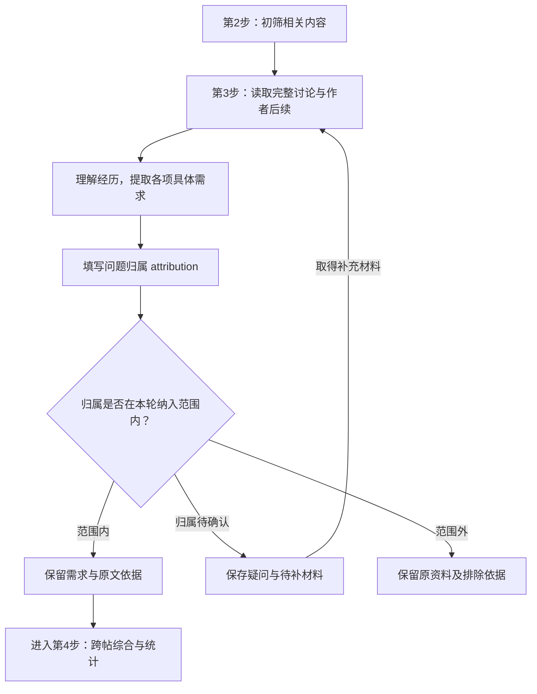

# 初筛与具体需求提取

本文件负责第二步初筛，以及第三步逐帖理解、需求提取和归因筛选。第三步输出保留的具体需求与原文依据，交给 [classification.md](classification.md) 进行第四步跨帖综合。

## 初筛做什么

先读取 `research.md` 中的研究问题与相关性标准。按照整段意思判断这段材料与研究问题的关系，以及是否表达困难、不满或具体愿望，保留相关原句。早期筛选的目标是找到值得深入阅读的内容。

### 判断与研究问题的关系

先说明本轮研究对象在使用过程中负责什么，以及它与其他工具的关系。逐项指出问题直接涉及的对象和发生环节，再依据原文中的任务、限制或选择判断关联。社区归属、用户身份、使用某个工具或出现主题词只提供定位线索。

- 需求直接涉及研究对象的选择、获得、接入、输入输出、服务表现或使用条件时，保留并写清依据。跨工具问题需指出原文描述的哪个具体交互、限制或结果受到影响。
- 工具中的其他问题，只有“这个工具使用研究对象”这一依赖关系时，关联尚未成立。保留问题原本所属的对象；进一步证据说明与研究主题的具体联系后再纳入。研究者设想的新用途或改善方案进入后续建议，并与用户表达的需求区分。
- 明确发生在主题范围之外的问题，保留原资料及筛选理由；它可以是其他研究的有效需求。
- 关系尚不清楚时保留待读，说明需要补充哪段经历、作者回复或工具背景。关键字缺失本身不能判定无关。

一篇帖子或一条评论可以包含多个问题，各项关系分别判断。部分内容相关时读取完整讨论，提取时仍按具体问题决定范围。

主题相关性在筛选与理解时判断。当前产品是否具备能力、能否新增功能、改善成本多大，留到价值判断；范围内的真实需求可以超出现有能力。

### 判断是否值得深入阅读

- 明确的使用困难、对实际结果的不满、寻找解决办法、带条件的愿望进入深入阅读。
- 经验分享、工具制作和正面评价中也可能有需求；根据经历判断。
- 单纯介绍功能、转发消息或提供建议时，保留其实际信息性质。
- 含义不清、需要图片或缺少上下文的内容保留，注明要读什么。

初筛阶段的原文依据可以短；形成具体痛点时必须读完整上下文。出现次数和产品能否改善在后续判断。

筛选结果保存为 JSONL（每行一条 JSON），字段为 `source_id`、`decision`、`evidence`、`reason`。`keep` 表示存在范围内的困难或愿望，`skip` 表示明确无关或没有相关需求线索，`uncertain` 表示关系或含义需要补读。`reason` 说明与研究问题的关系及保留、略过或待读的理由。证据直接摘录当前正文或评论；图片不足以判断时，说明缺少的内容。分段记录同时保留 `part`。同一来源任意一段保留或不确定，就读取该来源的完整讨论。

## 用情境模型读懂讨论

情境模型指阅读者对文本所描述事件形成的理解。它把事件中的人物、目标、时间、场景和因果联系起来，说明事情怎样发生、怎样变化。本节借鉴 Zwaan 等人的事件索引模型；原研究中的空间维度关注实际位置，本任务另外记录影响使用过程的软件环境。[原始论文](https://memorylab.nd.edu/assets/257376/zwaan_radvansky_hilliard_curiel_1998_scientific_studies_of_reading_.pdf)

| 关系 | 框架关注什么 | 在帖子和评论中怎样分析 |
| --- | --- | --- |
| 人物 | 谁参与事件，前后是否还是同一个人 | 找到经历属于谁、谁在建议、谁在引用别人。发帖人与评论者的目标和结果分别保存 |
| 目标 | 当事人想达到什么，目标是否改变 | 从原文提取任务和希望的结果；解释某个操作怎样帮助或妨碍目标。隐含目标写出推断依据 |
| 时间 | 事件的先后、持续与变化 | 连接最初状态、尝试、结果和后续补充；同时看评论回复关系，保留问题已经解决或后来再次出现的变化 |
| 场景 | 事件在什么环境中发生，环境变化是否影响含义 | 记录与问题有关的地点、设备、客户端、模型、供应商、配置及预算。工具之间的职责查阅对应资料后再解释 |
| 因果 | 哪个事件导致另一个事件，依据是什么 | 将实际观察、当事人的原因判断、评论者猜测分开。只有先后关系时记录顺序；原因得到原文或其他证据支持后才作相应归因 |

### 实际阅读顺序

1. **取得完整讨论。** 读取正文、相关回复、作者补充和承载关键信息的图片或链接。先指出会影响理解的缺失内容。
2. **识别人物和目标。** 确定每段经历属于谁、在完成什么，以及这段发言是在求助、比较选择、回顾经历还是分享办法。把其他人的经历另行记录；将建议与已经执行的操作分开。
3. **还原事情经过。** 沿事件顺序整理当时条件、采取的操作、观察到的结果。场景发生变化时保留具体改变，避免把前后两个条件下的结果混合。
4. **用后续更新理解。** 新回复解释了操作、作者尝试了办法或确认解决时，同步更新 `situation`、`statement` 和解决状态。作者最后明确的目标、取舍与选择条件进入主要描述，`follow_up` 保留得出这一理解的后续经过。意见冲突时分别保留主张和依据。
5. **补足影响含义的知识。** 将不懂的地方写成具体问题，查阅相关工具资料后返回原段落解释。当前功能与历史使用条件分别说明。
6. **形成可追溯的解释。** 在 `situation` 写清人物、目标、条件、经过和有依据的归因，在 `follow_up` 写后续，在 `uncertainty` 写尚未确认的原因；每项关键判断由 `evidence` 指向原文。

这一阶段的产出是对每篇讨论的具体理解。能够解释当事人的目标、操作为何出现、实际发生什么、后续改变了什么，才进入该条问题的提取。资料没有提供的内容保留未知。

## 用语用推理理解隐含诉求

语用推理指结合话语、交流情境和相关背景，理解说话者希望别人领会的意思。当表面抱怨或功能建议还不足以说明具体障碍，或作者的后续回应改变了原来的解释时，在完整讨论中使用本节方法。

### 理论内容与来源

**会话含义理论，H. P. Grice，1975。** 区分一句话明确说出的内容与说话者在具体语境中借它传达的含义。合作原则指交流通常围绕参与者认可的目的进行；信息量适当、真实有据、相关、清楚是理解发言时的预期。听者结合这些预期、字面内容、前后交流和共享背景推断含义。含义会随语境或后续说明改变，字面表达与隐含意思可以同时成立。原文为 *Logic and Conversation*（逻辑与会话），收录于 *Syntax and Semantics, Volume 3: Speech Acts*（句法与语义，第 3 卷：言语行为），第 41—58 页。[原文全文](https://web.stanford.edu/class/psych205/papers/Grice-1975.pdf)

**关联理论，本节依据 Deirdre Wilson 与 Dan Sperber（2004）的理论综述。** 关联取决于信息能带来多少有用的理解，以及处理它需要多少努力。认知原则认为人的认知倾向于获得较高关联；交际原则认为有意传达的信息会使听者期待它值得理解。理解者借助语境形成关于说话者意思的解释，并在阅读过程中共同调整字面内容的具体解释、背景假设与隐含结论。原文为 *Relevance Theory*（关联理论），收录于 *The Handbook of Pragmatics*（语用学手册），第 606—632 页，DOI：`10.1002/9780470756959.ch27`；重点阅读第 4 节关于关联与理解的讨论。[作者提供的全文](https://www.researchgate.net/publication/229743338_Relevance_Theory)

会话含义理论提供字面内容与语境含义的区分；关联理论进一步解释理解者怎样利用语境推断意思。两者属于语用学与认知研究。下列步骤是本 Skill 将这些理论用于社区需求提取的应用设计；原论文研究人类交流与理解，未检验本 Skill 的提取准确率。

### 怎样从表面抱怨理解具体障碍

1. **把表达放回发生经过。** 保留用户实际说出的抱怨或建议，连接他当时的目标、操作、限制和结果。明确他在什么情况下提出这句话，以及它回应了什么事情。
2. **利用回复理解诉求。** 阅读作者接受或拒绝建议的理由、反复强调的条件，以及对他人理解的纠正。其他评论者的解释可以提供线索；作者认可、实际尝试和后续结果分别提供相应依据。
3. **比较有上下文支持的解释。** 存在不同理解时，比较哪种解释能够说明具体操作、着重强调的条件和对建议的回应。随着新材料进入阅读更新解释；只有标题支持、却与后续矛盾的解释需要修正。能同时成立的含义分别保留。
4. **形成具体需求并说明推断。** 先理解作者希望读者领会什么，再结合实际经历写出受阻的步骤或希望改变的条件。原文已经明确表达的困难继续保留；隐含诉求写出从原文和背景到结论的推断依据。资料仍支持多种理解时，保留共同能确认的部分与尚未确定的解释。

在 `situation` 中保存原表述、相关情境及隐含诉求的推断依据，`evidence` 保留支持解释的原句，`follow_up` 保存作者回应，`uncertainty` 保存未确定的解释。阅读稿把原话与提取出的需求放在一起，并标明哪些含义来自上下文推断。结论的具体程度以证据为限，缺少上下文依据的心理动机保留未知。

## 从经历中找到重点

围绕用户希望达到的结果与实际经历之间的差距阅读。关注作者着重解释的困难、为解决问题采取的行动，以及时间、费用、操作负担和体验影响。

反复调整配置可能在解决困难，也可能出于研究兴趣；读清作者提供的理由。用户寻找工具可能只有明确目标，尚未经历失败；这样的内容记录为需求。

痛点成立需要原文支持具体目标和实际障碍或代价。泛泛情绪保留为情绪证据，继续阅读后再判断能否提取具体问题。

## 用质性内容分析提取

质性内容分析把原文中表达同一意思的内容整理成较短、保留核心含义的描述，再比较这些描述形成类别。原文、简述和类别是不同层次；每次提炼都保留与上一层的对应关系。[原始论文](https://doi.org/10.1016/j.nedt.2003.10.001)

| 层次 | 内容 | 本任务的产物 |
| --- | --- | --- |
| 意义单元 | 围绕同一意思的相关语句，可以跨正文与后续回复 | 原文摘录及上下文，保留各自说话人 |
| 保留原意的简述 | 缩短表达，同时保留影响意思的条件 | 用户目标、实际障碍或愿望、影响和后续情况 |
| 具体问题 | 给这项简述一个准确的名称 | 一条 `finding`（具体分析记录） |
| 共性类别 | 多条具体记录中的共同目标、障碍或希望结果 | 归纳阶段形成的 `need_id` 与类别说明 |

### 从一篇讨论提取具体问题

1. **划分表达的意思并确定范围。** 根据已经读懂的经过，找出每一项独立困难或愿望，分别判断与本轮研究问题的关系。表达同一个问题的前后补充联系起来；不同目标或障碍分别处理。明确无关的内容保留筛选理由；关联仍不明确的内容留在待读记录中，写清所缺证据。
2. **缩写并保留条件。** 写清在什么情况下做什么、哪里受到阻碍、造成什么影响，或者希望获得什么结果。预算、使用工具、选择条件和已经解决的情况只要影响含义就保留。回顾已解决困难时写明其历史经过与结果，供综合时理解过去的选择。
3. **判断记录类型。** 原文支持具体障碍或负担时记录 `pain`；表达具体希望但没有说明实际困难时记录 `need`。泛泛情绪继续保留原文，尚无法具体化时说明缺少的信息。
4. **写成单项记录。** `statement` 只表达一项问题；用具体条件与障碍说明它，避免提炼后只剩宽泛的质量要求。影响不明时留空，原因不明时保留现象。
5. **保存逐帖结果和问题归属。** 每篇深入阅读的帖子形成一个分组，正文与评论的具体问题分别记录。根据已有归因填写 `attribution`；具体愿望按它涉及的对象填写。`situation` 写清原文支持的任务、障碍与研究对象的关系。跨帖综合留到归纳阶段。

用户描述的功能缺失可以形成需求。原文明确提出了功能方案时保留该方案，结合正文和评论说明它要支持的任务；目的需要根据上下文推断时，使用本文件的语用推理方法并保存依据。资料尚未支持的目的保留未知。

根据已有归因，按下节填写标签。逐条记录只增加 `attribution` 一个字段；后续去留由该标签与本轮纳入范围决定。

## 按归因筛选

这项判断在第三步逐条提取后完成。每条具体记录填写一个 `attribution` 标签，说明痛点的归因对象，或愿望所涉及的对象。模型 API 研究可采用以下名称；其他研究按实际对象确定名称，在 `research.md` 中统一记录标签及纳入范围。

| 标签 | 内容 |
| --- | --- |
| API服务 | 模型访问、充值计费、调用条件、路由等服务问题 |
| 模型能力 | 已有情境和原文支持的模型任务表现或能力需求 |
| 客户端 | 客户端自身的界面、实现或配置问题 |
| 本地环境 | 用户电脑、系统或本地运行环境问题 |
| 其他 | 已明确归属的其他对象 |
| 待确认 | 归属尚不明确 |

本轮研究范围决定纳入哪些标签。明确属于范围外的标签排除，`待确认` 继续保留在分析资料中。API 服务研究通常纳入 `API服务` 与 `模型能力`，具体以已确认目标为准。归因依据写在现有 `situation` 中，逐条需求无需另存处理结果字段。

本地过程资料保存全部记录；第四步使用纳入标签的记录，Notion 总报告与过程页面也只展示这些需求。缺少标签的旧记录先根据原文补全，再参与综合与统计。

## 逐帖结果与共性结果的关系

先完成每篇入选帖子的具体记录，再使用 [classification.md](classification.md) 比较这些记录。

- 一篇帖子可以有零项、一项或多项具体问题；没有提取出问题时保留阅读结果和原因。
- 评论者独立表达的痛点或愿望单独形成记录，归在所属帖子下并链接到该条评论。
- 同一人的后续说明用于更新原问题；后续确实提出另一项独立问题时再增加记录。
- `findings.jsonl` 保存带问题归属标签的逐条结果。展示和统计按本轮纳入标签筛选；保留项进入过程文档，并据此形成需求汇总中的共性需求或独立需求。

## 一条分析记录

`findings.jsonl` 每行一项具体痛点或需求：

| 字段 | 内容 |
| --- | --- |
| `id` | 本次研究内唯一的记录编号 |
| `source_id` | 表达该问题的原帖或评论编号，使用 `t3_` 或 `t1_` 前缀 |
| `kind` | `pain` 或 `need` |
| `attribution` | 一个问题归属标签，采用本文件“按归因筛选”中的统一名称及本轮纳入范围 |
| `situation` | 发言目的、用户任务、工具、条件、尝试、结果和有依据的归因，及其与研究问题的关系；存在隐含诉求时保存原表述与推断依据 |
| `statement` | 根据完整经历与作者后续确定的一项具体障碍或希望结果，保留影响含义的选择条件和状态 |
| `evidence` | 原文依据列表，每项包含 `source_id` 和 `quote`；保留英文原文，中文解释另写 |
| `follow_up` | 谁提出什么解释，作者是否认可，后来如何 |
| `resolution` | `resolved`、`unresolved` 或 `unknown`，按当前记录的实际后续填写 |
| `uncertainty` | 哪些原因或推断仍不明确，以及尚无法区分的解释；没有则写空字符串 |
| `need_id` | 汇总后填写对应需求编号，共性与独立需求都使用编号；提取阶段及未纳入的记录可以留空 |
| `discussion_id` | 集中讨论帖中独立问题的起始评论编号；普通帖子可省略 |

`source_id` 指向实际表达需求的正文或评论，其作者用于账号统计。解释这个需求的其他评论放入 `evidence` 和 `follow_up`。计数以表达来源为准，建议者和反驳者分别保留信息性质。

`resolution` 使用现有材料中最后有依据的状态：

- `resolved`：该条具体问题已经消除或目标已经达到，有明确反馈或结果支持。
- `unresolved`：仍有具体障碍或尚未达到目标；部分改善后原文明确仍有困难时也使用此值。
- `unknown`：没有足以判断的结果，或改善后是否满足目标仍不清楚。

没有新回复时保留此前明确的状态，并说明后续未知。同一经历中的不同问题分别判断解决状态。

原文没有说明的动机、代价或后果可以留空。缺少充分含义的材料继续保存在筛选记录中，等待补读。仅有服务故障时记录具体故障，研究价值在能力核查后判断。

## 用户重点审查

集中展示会改变主要结论、存在分歧或容易误读的材料：原文、必要上下文、当前解释和具体疑问。用户纠正一个概念后，检查采用同一解释的相关记录，更新其共性归属与统计。

相关背景和明确的原意判断写入 `research.md`，后续批次继续使用。

## 方法依据

- [Zwaan 等，1998，阅读时构建多维情境模型](https://memorylab.nd.edu/assets/257376/zwaan_radvansky_hilliard_curiel_1998_scientific_studies_of_reading_.pdf)：人物、目标、时间、因果关系进入理解。
- [Graneheim 与 Lundman，2004，质性内容分析](https://doi.org/10.1016/j.nedt.2003.10.001)：结合上下文划分意义、保留核心含义缩写，再比较和归类。
- [Griffin 与 Hauser，1993，客户的声音](https://mitsloan.mit.edu/shared/ods/documents?PublicationDocumentID=5259)：从用户自己的表达识别具体需求，再组织与判断优先次序。

这里的 Agent 阅读安排是针对社区研究的应用设计。
