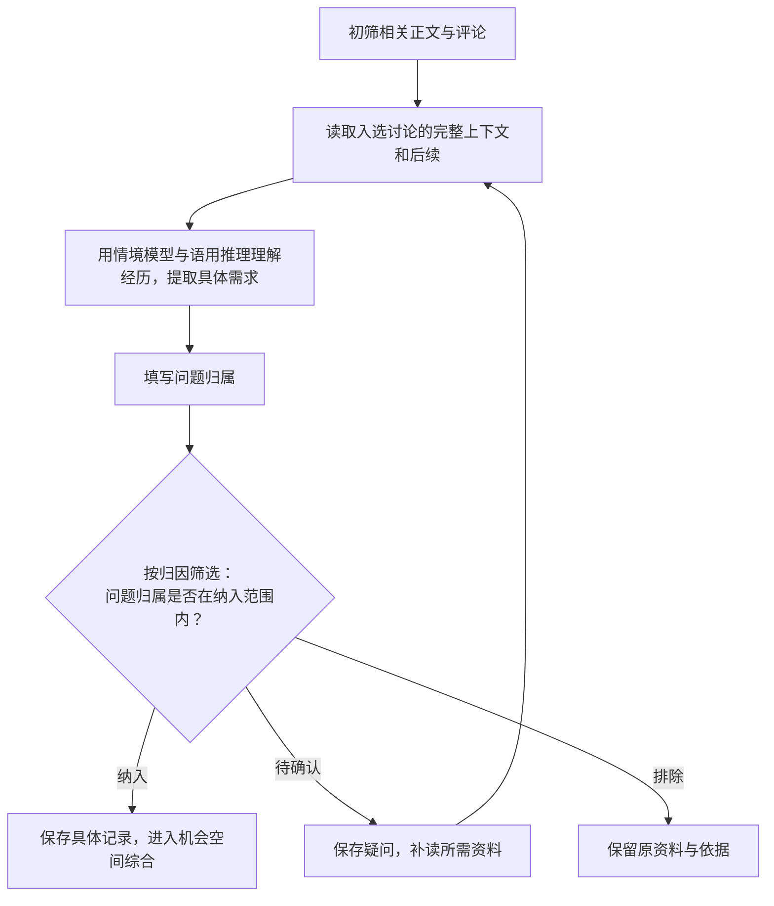

# 初筛与具体需求提取

本文件负责第二步初筛和第三步逐帖分析。产出具体需求与原文依据，交给 [classification.md](classification.md) 综合构建机会空间树。

## 按相关性初筛

读取 `research.md` 中的目标和范围，结合整段意思判断相关性。社区名称、工具名称和关键词用来定位资料；原文中的任务、困难和愿望决定是否值得深入阅读。涉及多个社区时，可按社区派发子代理并行处理初筛批次。

| 判断结果 | 具体条件 | 保存什么 |
| --- | --- | --- |
| 保留 `keep` | 原文说明了与研究对象有关的具体困难、不满、寻找办法或愿望；经验分享与正面评价也可提供这些线索 | 相关原句，以及它涉及本轮哪项任务或问题 |
| 排除 `skip` | 内容明确属于本轮范围之外，或只介绍、转发信息，未提供相关需求线索 | 原句与具体排除理由 |
| 待读 `uncertain` | 缺少上下文、图片、作者后续或工具背景，尚无法确定关系或含义 | 已知线索与需要补读的内容 |

正文和评论分别判断。一篇讨论可有多项问题，每项按实际涉及的对象筛选。含义不清或主要信息在图片、外链中时，记录需补读的内容。

此阶段依据原文与研究目标的联系作出决定。产品当前的能力与实施成本留到第四步评估，范围内的真实需求可以超出现有能力。

筛选结果保存为 JSONL（每行一条 JSON）：

| 字段 | 内容 |
| --- | --- |
| `source_id` | 当前正文或评论的来源编号 |
| `decision` | `keep`：保留；`skip`：排除；`uncertain`：待读 |
| `evidence` | 当前来源中的原句 |
| `reason` | 与研究问题的关系及判断依据 |

分段筛选时保留 `part`。同一来源有任何一段保留或待读，就读取完整讨论。

## 用情境模型与语用推理提取真实需求

阅读讨论时，将 **情境模型** 与 **语用推理** 结合使用，从表面原话推导出用户的真实需求：

- **情境模型（Situation Model）**：在阅读时还原整件事的来龙去脉，把人物、目标、时间顺序、软件与预算环境、前因后果连成完整的过程。
- **语用推理（Pragmatic Inference：会话含义理论与关联理论）**：把用户的字面抱怨或提问放回上述完整情境中，结合上下文推断他话里真正在意的问题和希望达成的改变（言外之意）。

**具体分析步骤（4 步拆解法）：**

通读主帖、相关评论解释与作者后续回复，遇到不熟悉的工具或术语先查清资料，再顺着以下 4 步拆解：

1. **看字面表达**：用户原话在抱怨什么、询问什么，或者分享了什么做法？
2. **还原完整情境（情境模型）**：他当时在什么工具、模型、预算或场景下，想完成什么具体任务？尝试了什么操作，结果如何，后续有没有解决？结合 `author_flair`（作者头衔）与 `post_flair`（主帖分类标签）辅助确认发言人角色和任务类型；遇到 `contested: true`（高争议讨论）时，一并通读评论区的正反交锋，不同发言人的经历分别还原。
3. **推断真正卡点（语用推理）**：结合他的目标和处境，他在那个情境下说出这句话，真正拦住他行动、让他不满意的具体障碍或代价是什么？
4. **写出具体需求并标注真实行动等级**：把推断出的真实诉求用直白、自然的口语短句写进 `statement`，直接说清用户想达成什么结果、卡在什么具体问题上；完整情境与原因写入 `situation`；评论解释与后续结果写入 `follow_up`；按用户在原文中已发生的动作填写 `action` 与 `action_evidence`。原文未说明且无法据此推断的部分保持未知。

一篇讨论可以提取多项独立问题。评论者的独立经历分别记录，同一人的后续补充用于更新原记录。

## 真实行动三档判定

每条需求记录按表达者在原文中**实际发生的动作**标注 `action` 等级，用于区分需求含金量，不凭情绪激烈程度打分：

| 等级 | 判定条件（须有原文事实） | `action_evidence` 要求 |
| --- | --- | --- |
| `acted` | 表达者已经为此付费、已经更换到其他服务商、或已经自己动手搭建替代方案 | 必填 `{"source_id": "...", "quote": "..."}`，引用同一表达者在同一讨论内的原句 |
| `seeking` | 当前任务明确受阻，表达者正在公开求助、对比选型或寻找替代工具 | 必填 `{"source_id": "...", "quote": "..."}`，引用同一表达者在同一讨论内的原句 |
| `expressing` | 单纯表达具体障碍、不满或愿望，尚未发生付费、更换或求助选型动作 | 省略或留空 |

## 按归因筛选

每项记录用一个 `attribution` 标签说明问题或愿望涉及的对象。模型 API 研究采用下列标签；其他研究按实际对象确定，并在 `research.md` 记录纳入范围。

| 标签 | 对象 |
| --- | --- |
| API服务 | 模型访问、充值计费、调用条件、路由等服务问题 |
| 模型能力 | 模型在具体任务中的表现或能力需求 |
| 客户端 | 客户端自身的界面、实现或配置问题 |
| 本地环境 | 用户电脑、系统或本地运行环境问题 |
| 其他 | 已明确归属的其他对象 |
| 待确认 | 归属尚不明确 |

API 服务研究通常纳入 `API服务` 与 `模型能力`。归因依据写入 `situation`，范围外及待确认记录保存在本地；确认纳入的记录进入需求综合。旧记录缺少标签时根据原文补全。

逐项说明原文中的哪个操作、限制或结果支持该归属。跨工具经历按具体问题分别归属；作者或评论者对原因的猜测保留为待确认解释。

- **范围内**：归属有原文依据，且标签在本轮纳入范围中，交给第四步判断机会价值。
- **范围外**：归属明确，标签不在本轮范围中，保留记录并在 `situation` 写明排除依据。
- **待确认**：在 `uncertainty` 写明缺少的经过或资料，补读后重新判断。

## 一条分析记录

`findings.jsonl` 每行保存一项具体问题：

| 字段 | 内容 |
| --- | --- |
| `id` | 本次研究内唯一的记录编号 |
| `source_id` | 表达该问题的正文或评论编号，采用 `t3_` 或 `t1_` 前缀 |
| `kind` | `pain`：具体障碍或负担；`need`：具体愿望 |
| `action` | 真实行动等级：`acted`（已付费/已换服务/已自建替代）、`seeking`（受阻求助或寻找替代）、`expressing`（纯表达） |
| `action_evidence` | `acted` 与 `seeking` 必填 `{"source_id": "...", "quote": "..."}`，须为同一作者在同帖内的原话；`expressing` 省略 |
| `attribution` | 问题归属标签 |
| `situation` | 用户目标、条件、经历、结果和有依据的解释 |
| `statement` | 用直白口语写清的一项具体障碍或期望结果 |
| `evidence` | 原文列表，每项含 `source_id` 与 `quote`；英文原文与中文解释分别保存 |
| `follow_up` | 相关解释、作者回应及后续结果 |
| `resolution` | `resolved`：明确已解决；`unresolved`：明确仍有困难；`unknown`：结果不明 |
| `uncertainty` | 尚未确定的原因或解释；没有则为空字符串 |
| `need_id` | 第四步填写的机会空间编号；提取阶段及未纳入记录可留空 |
| `discussion_id` | 集中讨论帖中独立问题的起始评论编号；普通帖子可省略 |

表达来源决定账号统计；其他人的解释放入证据或后续。保存表达者的原句，使结论能够返回原文。缺少的信息保留为空或未知。
