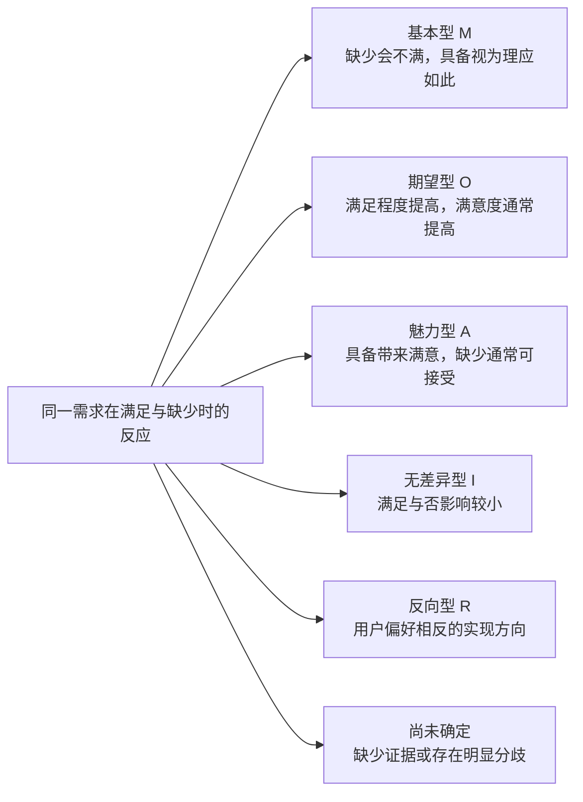

# 按未解决的研究问题选择专题

先写清：基础五模块已经回答了什么，仍有什么问题无法说明，加入专题后需要得到什么结论。已有内容足以回答时直接使用；资料不足时补充证据。专题复用逐帖记录、共性说明和数量，增加解释问题所需要的结构。

用户明确要求某个专题时直接执行。只做社区选择等局部任务时，该专题就是本阶段交付。

## 社区对比与选择

**启用条件：**需要决定重点研究哪些社区，或解释社区差异如何影响需求判断。

**方法内容：**Kozinets 的网络民族志方法包含“进入社区”的步骤：从与研究问题相关的网上群体中，比较参与情况、材料细节和成员互动，判断哪里能够提供所需证据。本专题采用其中的社区选择方法。

**怎样分析：**

1. 明确需要了解的用户任务和问题，列出候选社区及其工具用途。
2. 在可比较的时间范围内阅读社区介绍、规则和真实讨论，说明参与者实际在做什么。
3. 比较研究相关性、发帖活跃度、不同发言者、经历描述的细节和成员互动；每项判断附资料范围与来源。
4. 说明各社区能够回答哪些问题、缺少哪些信息，以及选择它的具体理由。需要保留不同人群或场景时说明其研究价值。

**怎样呈现：**社区对比表，包含主要活动、与研究问题的关系、材料数量、资料丰富程度、重要差异和选择理由；附代表讨论。数值采用实际取得的数据，抽样结果标明范围。

**原文与真实案例：**[Kozinets，2002，《The Field Behind the Screen》（屏幕背后的田野）](https://www.researchgate.net/publication/235360688_The_Field_behind_the_Screen_Using_Netnography_for_Marketing_Research_in_Online_Communities)。查看 *Entrée*（进入社区）和咖啡社区研究方法部分。作者比较多个咖啡讨论群后，选择讨论活跃、资料丰富的 `alt.coffee`，说明社区选择应围绕研究所需的材料。

## 主要用户画像

**启用条件：**不同使用目的、条件或取舍明显影响需求，需要说明主要服务哪些人。

**方法内容：**画像将一组有证据的目标、行为和使用条件整理成可理解的人群描述。Pruitt 与 Grudin 的方法要求画像中的目标、顾虑和典型活动与支撑材料保持联系，便于判断这些特征从哪里来。

**怎样分析：**

1. 连接同一作者的目标、操作和具体问题，先形成完整的个人使用经历。
2. 比较不同作者的目标、使用条件和行为组合，寻找能够解释需求差异的共同模式。
3. 只有差异会改变用户的需求、选择或取舍时，才形成不同画像；保留同一作者跨多种使用方式的情况。
4. 为画像每项主要特征关联具体记录和原文，说明共同点、内部差异以及与其他画像的重叠。

**怎样呈现：**画像卡片或对比表，列出核心目标、发生情境、典型行为、关键需求、重叠情况和证据。年龄、职业等信息按实际自述标注；用户明确要求示意人物时，示意设定与研究事实分别说明。

**原始依据：**[Pruitt 与 Grudin，2003，《Personas: Practice and Theory》（用户画像：实践与理论）](https://www.microsoft.com/en-us/research/wp-content/uploads/2017/03/pruitt-grudinold.pdf)。查看第 2 页 *Creating and Using Personas: Our Approach*（创建及使用画像的方法）及 *foundation document*（画像依据文档）部分，重点是画像特征与证据的对应关系。

## API 平台与供应商评价

**启用条件：**需要解释用户为什么选择、更换、保留或放弃服务商，基础需求列表还不能说明这些选择。

**方法内容：**借鉴客户声音研究中三个层次的区分：用户想获得的好处、用户感受到的表现、产品可以核实的技术能力。平台评价围绕用户任务组织，同时保留这三类信息及其关系。

**怎样分析：**

1. 从逐帖记录提取用户的任务、选择条件、服务商、使用时间、实际体验和选择结果。
2. 找出真正影响选择的评价方面，分别整理支持、反对和有条件的评价。
3. 查阅对应时期的官方能力与服务说明，区分功能是否存在、用户是否找到、实际使用是否满足任务。
4. 比较同一任务下不同服务的满足情况，说明更换原因、仍存在的困难与切换条件。已有讨论数量直接复用。

**怎样呈现：**按用户任务组织对比表，每项展示用户要求、评价原文、官方能力、实际使用结果和选择理由。平台当前缺少的功能可进入新增能力建议，注明对应需求。

**原始依据：**[Griffin 与 Hauser，1993，《The Voice of the Customer》（客户的声音）](https://mitsloan.mit.edu/shared/ods/documents?PublicationDocumentID=5259)。查看重排版第 3—4 页的图 1、客户需求及用户感知表现部分。原文通过显示器研究区分所需使用效果、用户感受与工程属性；本专题将这一关系用于平台选择分析。

## 模型评价

**启用条件：**需要回答某种任务适合哪些模型，或解释对同一模型的评价为什么不同。

**框架内容：**HELM 将模型评估组织为场景、使用方式和指标。场景说明任务、领域和语言；使用方式说明输入如何交给模型及模型如何被调用；指标说明按什么标准判断结果。这些条件决定评价能够适用于哪里。

**怎样分析：**

1. 按任务、语言、模型版本、供应渠道、使用时间和已知配置整理材料。
2. 提取每条评价实际针对的方面，关联原始任务、提示、输出或用户描述。
3. 在可比较条件下整理优点、问题和分歧；条件不同的材料保留这些区别。
4. 需要性能结论时读取相同条件下的评测或开展明确授权的测试。社区意见数量与实际性能指标分别报告。

**怎样呈现：**任务与模型对比表，包含评价方面、适用条件、正反意见、讨论数量和原文。性能数值注明测试条件和出处。图表可以展示讨论中的意见分布，模型选择结论同时说明适用任务。

**原始依据：**[Liang 等，《Holistic Evaluation of Language Models》（语言模型的整体评估，HELM）](https://arxiv.org/pdf/2211.09110)。查看第 2—3 节的场景与使用方式，以及效率指标部分对部署条件的说明。

## 用户旅程

**启用条件：**问题涉及先后顺序、跨工具操作、等待、重复尝试或中途放弃，单独列出痛点还无法说明问题怎样发生。

**框架内容：**用户旅程描述用户为了一个具体目标，与一个或多个服务方发生的一系列互动。阶段表示任务推进到哪里；接触点表示一次具体交互；体验是用户对这些交互的感受。实际发生的事件与主观体验分别记录，再分析它们之间的关系。

**怎样分析：**

1. 明确本轮用户任务、涉及人群、起点和结束条件。
2. 从一篇完整经历开始，按实际顺序记录操作、工具或渠道、等待、障碍、后续行动和结果，附证据。
3. 比较相同任务的其他经历，归纳共同阶段和真实分支。综合多人的路径时标明是综合整理，并保留个人差异。
4. 找出重复操作、交接、等待和放弃发生在哪里，分析前一步的条件如何影响后一步。因果依据不足时标明待确认。
5. 有正式操作流程时比较预定流程与实际经历，说明差异及其后果。情绪仅使用用户明确表达的内容。

**怎样呈现：**交付一张 Mermaid 流程图和一张证据表。

- 图中阶段名称来自本轮实际任务；节点说明主要动作和对应痛点编号。
- 确认的先后关系使用实线；顺序或关系尚不明确时使用虚线并注明。
- 实际出现的分支、重复尝试和终止路径直接画出。
- 证据表列出阶段、目标、动作、工具或渠道、障碍、结果、情绪原话及来源。没有表达情绪时标明未表达。
- 图中的每项痛点能返回逐帖记录。缺少的阶段保留空缺说明。

**原始论文与案例：**[Halvorsrud、Kvale 与 Følstad，2016，《Improving service quality through customer journey analysis》（通过用户旅程分析改善服务质量）](https://www.sintef.no/globalassets/sintef-digital/hci/halvorsrud_2016_customer_journey_analysis.pdf)。表 II 与图 3 说明分析过程，图 6 展示 Telenor 宽带用户的真实旅程。说明信与 PIN（个人识别码）的延误影响了后续安装，重建事件顺序后才能看清这些联系。

## Kano 需求分类

**启用条件：**已有具体需求，但仍需了解满足或缺少这些需求会怎样影响用户满意度。

**框架内容：**Kano 关注同一需求在“得到满足”和“没有得到满足”两种情况下的反应。

| 类别 | 满足与缺少时的关系 |
| --- | --- |
| 基本型 M | 缺少会不满；具备通常被视为理应如此 |
| 期望型 O | 满足程度提高，满意度通常提高；不足会带来不满 |
| 魅力型 A | 具备带来满意；缺少通常不会引起不满 |
| 无差异型 I | 满足与否对满意度影响较小 |
| 反向型 R | 用户偏好与预设的功能实现方向相反 |

另有 Q，表示回答矛盾或可能未理解问题，单独记录。

### 怎样分析

1. 定义一项具体需求及其适用人群、场景，明确“满足”和“缺少”分别指什么状态。
2. 阅读这两个状态下的实际反馈，保留说话人和原文。只有一侧证据时说明另一侧未知；不同人的发言各自保留。
3. 只有社区讨论时，输出有证据的分类假设及未确定之处。数量、情绪强烈程度和功能的新旧，分别作为材料信息保留。
4. 有正式调查时，对同一个人、同一项需求分别询问“得到满足时有什么感受”和“没有得到满足时有什么感受”。两题各使用喜欢、理应如此、无所谓、可以接受、不喜欢五类回答。
5. 将同一人的成对回答按原文图 4 的评价表分类，再汇总每项需求的类别分布、样本量和人群差异。存在分歧或类别接近时保留分布。

正式问卷的回答类别用于查表，不作连续分数相加。自然讨论形成的假设保留其证据范围。

### 怎样画图与展示

默认用 Mermaid 分类图承载实际需求编号与简述，旁边提供证据表。图标题标明来自社区材料的分类假设或正式问卷结果。下面是分类图的结构说明；交付时按实际分析填写需求，没有依据的分类保留为空。

证据表包含需求编号、人群与场景、满足时反馈、缺少时反馈、分类或分类假设、依据和缺失信息。正式调查另展示各类人数或比例，Q 单独标示。

需要解释经典曲线时，说明横轴为需求满足程度、纵轴为满意度：基本型主要体现缺失带来的不满，期望型随满足程度变化，魅力型主要体现具备后的满意。原文图 2 为概念示意；实际需求的坐标或满意度数值需要相应数据。

Kano 说明满意度关系。开发优先次序另结合使用范围、问题影响和实施条件判断。

**原始方法与实践：**[Berger 等，1993，《Kano’s Methods for Understanding Customer-defined Quality》（理解用户所定义质量的 Kano 方法）](https://www.walden-family.com/public/cqm-journal/2-4-Whole-Issue.pdf)。原文图 2 解释曲线，图 3—4 给出成对问题和评价表；第 III 节保留实际产品项目经验。
