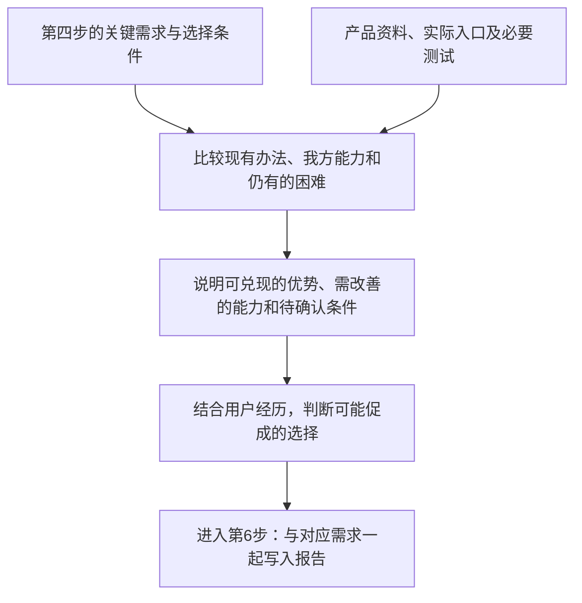

# 第五步：产品能力与改善价值

输入是第四步已经综合出的关键需求，核心目标见 [SKILL.md](../SKILL.md#核心研究目标)。本步骤核查我方实际能力与用户选择条件的匹配，形成有依据的产品价值判断。

先明确本轮评估哪个产品或平台，将用户正在使用的工具与拟改进的平台分别列出。核查工具、平台、模型、供应商分别负责什么，以及现有办法是否充分满足需求。

**平台目前没有的功能可以作为新增能力提出**，说明它对应哪项真实需求、支持什么任务、预计改善什么，以及哪些实现条件还待确认。

| 现有能力情况 | 分析与提议 |
| --- | --- |
| 已有且能够满足需求 | 记录现有办法及使用条件，说明是否还有未覆盖的情况 |
| 已有但仍有使用困难 | 明确配置、操作、效果、费用等具体负担，提出需要改善的过程 |
| 当前缺少相应能力 | 保留用户希望的结果，提出新增功能或服务能力，并列出需求依据、职责范围和可行性疑问 |
| 尚未确认 | 说明核查过的材料与未确定之处，补充资料后再判断 |

功能缺失要结合官方资料、实际入口或必要测试判断。用户找不到功能时，先明确实际能力和使用困难；未查到说明时保留尚未确认。原始需求保留。平台临时故障、客户端能力和上游服务问题对产品机会的意义分别说明；需要跨多方才能解决时，说明涉及哪些职责。

每项价值判断写清：对应的 `need_id`、现有办法、仍然存在的困难、我方可兑现的改善、预期帮助谁完成什么，以及证据和未确定条件。提出新功能属于改善建议，现有能力与建议中的能力分别标明。

当研究目标包含试用、付费或迁移时，将已综合的关键需求与我们能够兑现的优势比较。对应的使用条件、更换成本、顾虑与证据写在该项需求下，说明哪些条件已满足、哪些需要改善或核实，以及材料支持何种行动。跨需求重复出现的条件可以另作概括，保留它们与具体经历的联系；试用、付费和迁移按材料中实际出现的选择分别解释。

这种选择分析参考 April Dunford 的 [A Buyer-Centric Approach to Competitive Positioning（从买方角度进行竞争定位）](https://aprildunford.substack.com/p/a-buyer-centric-approach-to-competitive)：从用户实际考虑的替代方案出发，说明差异带来的用户价值及更换代价。社区材料支持选择理由的假设，实际转化表现由后续真实投放与使用数据检验。

正文优先解释对本轮决定有意义的发现，并说明判断依据；完整目录保留全部需求和数量，低频及独立需求照常呈现。必要时针对关键缺口补充原帖、官方文档或实际测试，随后按 [delivery.md](delivery.md) 交付。
